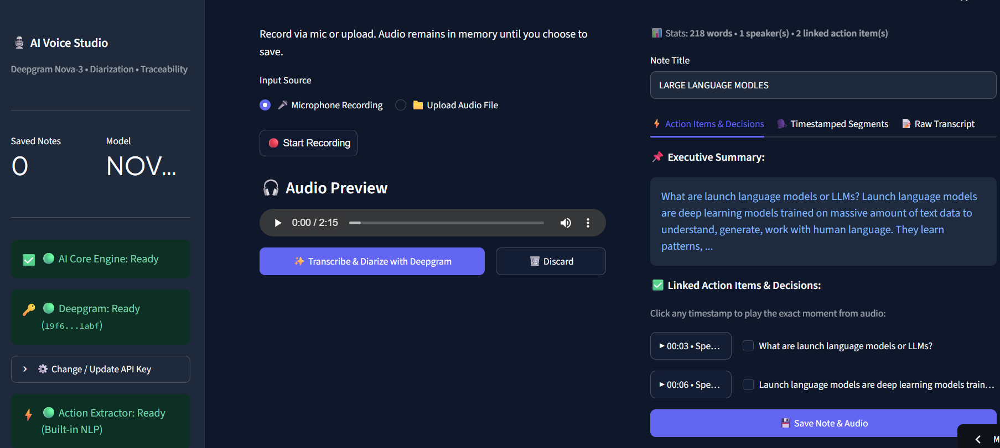
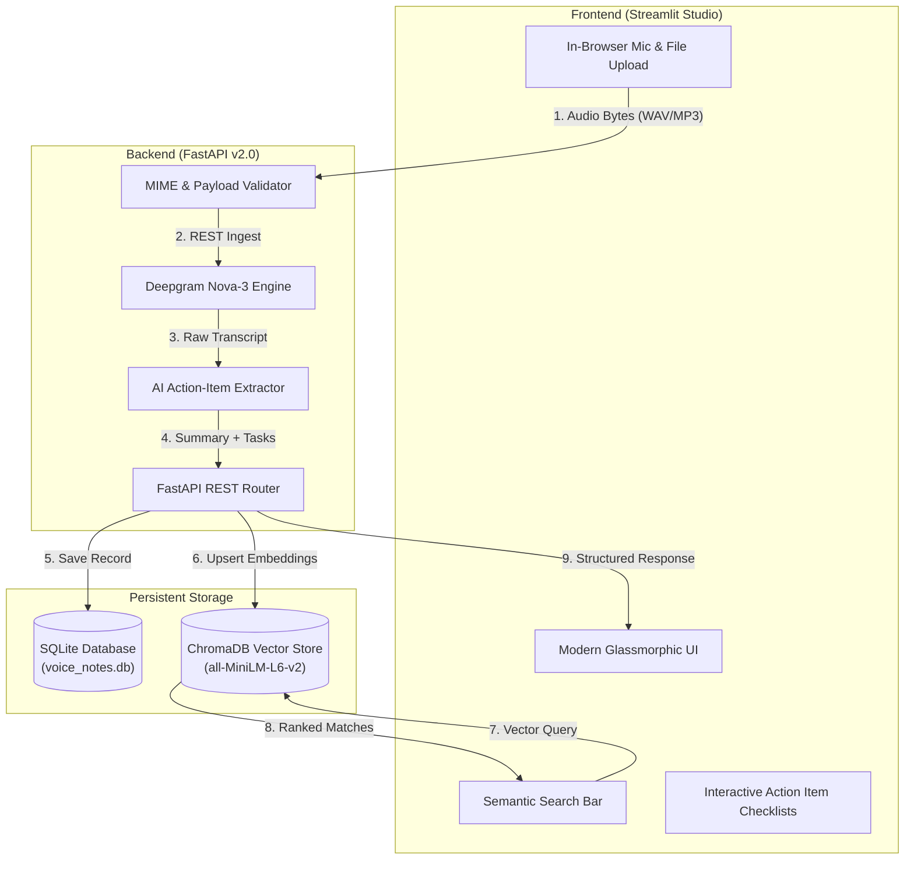

<div align="center">
<div align="center">

# 🎙️ Vocalis: AI Voice Assistant & Action-Item Extractor

**A full-stack, AI-powered voice assistant featuring sub-second Deepgram Nova-3 transcription, automatic LLM action-item and summary extraction, and semantic vector search via ChromaDB.**

[](https://python.org)
[](https://fastapi.tiangolo.com)
[](https://streamlit.io)
[](https://deepgram.com)
[](https://trychroma.com)
[](LICENSE)
[](https://doi.org/10.5281/zenodo.24442640)

[**🌐 Live Demo**](https://streamlit.app) • [**📖 Architecture**](#-system-architecture) • [**⚡ Features**](#-key-features) • [**🚀 Quickstart**](#-quickstart)

</div>

---

## 📽️ Demo Preview

```text
 ┌─────────────────────────────────────────────────────────────────────────────────┐
 │  🎙️ Speak or Upload Audio  ──►  ⚡ Deepgram Nova-3 (sub-second speech-to-text)   │
 │                                                  │                              │
 │                                                  ▼                              │
 │  🧠 ChromaDB Vector Embeddings  ◄──  📋 AI Action-Item & Summary Extractor      │
 │  🔍 Semantic Search by Meaning       (Checkable To-Dos, Deadlines & Tasks)      │
 └─────────────────────────────────────────────────────────────────────────────────┘
```



---

## ⚡ Key Features

- 🎙️ **Multi-Source Audio Ingestion**: Record audio directly in-browser using `streamlit-mic-recorder` or upload pre-recorded memos (`.mp3`, `.wav`, `.m4a`, `.ogg`, `.webm`).
- ⚡ **Deepgram Nova-3 Speech Intelligence**: Sub-second speech recognition with automatic punctuation, casing, and audio formatting.
- 📋 **Flagship: AI Action-Item & Task Extractor**: Automatically parses voice recordings into **executive summaries** and **actionable to-do checkboxes** using LLM intelligence (Gemini / Groq / OpenAI with smart NLP fallback).
- 🧠 **Semantic Vector Search (ChromaDB)**: Search notes by *intent and meaning* rather than exact keyword matches (e.g. searching *"dinner plans"* retrieves *"remember to pick up pasta and tomato sauce"*).
- 🗑️ **Two-Tier Delete & Discard Safety**: Discard bad recordings before saving, or delete indexed notes from both SQLite and ChromaDB vector space with one click.
- 📥 **Formatted Exports**: Export notes, summaries, and action checklists into structured `.txt` files anytime.

---

## 🏛️ System Architecture



---

## 🛠️ Tech Stack

| Layer | Technology | Purpose |
| :--- | :--- | :--- |
| **Frontend** | Streamlit, Streamlit Mic Recorder | Responsive glassmorphic dashboard & mic recorder |
| **Backend API** | FastAPI, Uvicorn, Pydantic v2 | High-performance asynchronous REST endpoints |
| **Speech-to-Text** | Deepgram Nova-3 API | Industry-leading speech-to-text accuracy and speed |
| **Action Extraction** | Google Gemini / Groq / NLP Rules | Extracts bulleted summaries and to-do action items |
| **Vector Database** | ChromaDB, Sentence-Transformers | Dense vector indexing (`all-MiniLM-L6-v2`) |
| **Database** | SQLite3 (Persistent WAL Mode) | Relational note metadata and checklist storage |

---

## 🚀 Quickstart

### 1. Clone the repository
```bash
git clone https://github.com/ruksana-ux/voice-notes-ai.git
cd voice-notes-ai
```

### 2. Set up a virtual environment
```bash
# Windows
python -m venv .venv
.\.venv\Scripts\Activate.ps1

# macOS / Linux
python3 -m venv .venv
source .venv/bin/activate
```

### 3. Install dependencies
```bash
pip install -r requirements.txt
```

### 4. Configure Environment Variables
Create a `.env` file in the root directory:
```env
# Required
DEEPGRAM_API_KEY=your_deepgram_api_key_here
DEEPGRAM_MODEL=nova-3

# Optional: Add an LLM key for enhanced action-item extraction (Gemini / Groq / OpenAI)
# GEMINI_API_KEY=your_gemini_key_here
# GROQ_API_KEY=your_groq_key_here

# Backend settings
BACKEND_HOST=127.0.0.1
BACKEND_PORT=8000
BACKEND_API_URL=http://127.0.0.1:8000
```

### 5. Launch the Studio
Run the unified command (auto-starts the backend and frontend together):
```bash
python -m streamlit run frontend/app.py
```
Open **[http://localhost:8501](http://localhost:8501)** in your browser!

---

## ☁️ Deployment on Streamlit Community Cloud

1. Fork or push this repository to GitHub.
2. Sign in to **[share.streamlit.io](https://share.streamlit.io)**.
3. Click **New app** and select:
   - **Repository**: `ruksana-ux/voice-notes-ai`
   - **Branch**: `main`
   - **Main file path**: `frontend/app.py`
4. In **Advanced Settings** &rarr; **Secrets**, paste:
   ```toml
   DEEPGRAM_API_KEY = "your_deepgram_api_key"
   DEEPGRAM_MODEL = "nova-3"
   # Optional
   # GEMINI_API_KEY = "your_gemini_api_key"
   ```
5. Click **Deploy!** 🚀

---

## 📄 License

Distributed under the MIT License. See `LICENSE` for more information.
